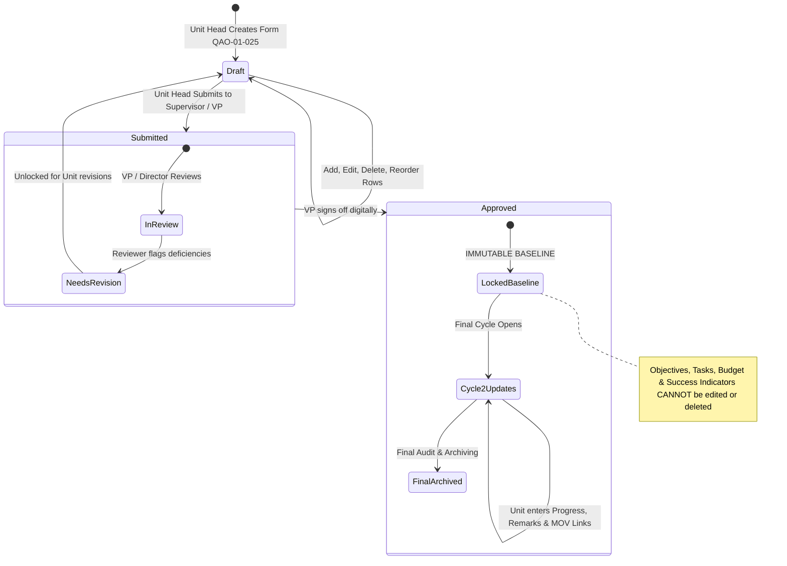

# OPERATIONAL PLAN & KPI MANAGEMENT SYSTEM

## Technical Specification & Implementation Guide (Form QAO-01-025)

**Document Control:** RSU-EOMS-SPEC-2026-001  
**Target Form:** Form QAO-01-025 (Creation: 2021-02-14, Revision: 2024-01-22)  
**Standard Compliance:** ISO 21001:2018 (EOMS Clauses 5.1, 6.1, 6.2, 7.5, 9.1, 10.1) & Civil Service Commission (CSC) OPCR/IPCR Standards.

---

## 1. Executive Overview

This specification establishes an interactive, evidence-backed operational planning and KPI system for Romblon State University (RSU).

The system transitions the university from static, unreadable Google Drive links to an **interactive, structured data entry module** for **Form QAO-01-025**, while maintaining a dual-mode toggle switch in Admin Settings to guarantee backward compatibility with legacy Google Drive submissions.

### The Core Paradigm Shift

```
[Legacy Workflow]
Unit fills Word/Excel ──> Saves to Drive ──> Pastes static link ──> Reviewer opens link ──> Manual review (No analytics)

[New QAO-01-025 Interactive Engine]
VP posts Annual Goals ──> Unit drafts structured rows ──> Automated KPI formulas ──> VP approves ──> STRICT LOCK
                                                                                                        │
                                                               ┌────────────────────────────────────────┴────────────────────────────────────────┐
                                                               ▼                                                                                 ▼
                                                Cycle 2 Progress & Remarks                                                        1-Click Printable Form QAO-01-025
                                                (Attainment % + Learnings)                                                        (With TÜV Rheinland ISO Logo & Signatures)
```

---

## 2. Dual-Mode Switch (Admin Settings)

To ensure zero operational disruption, the application provides an **Admin Toggle Switch** in `Settings > System Settings > EOMS Submission Engine`.

- **Mode 1: Legacy Drive Link (`legacy_link`):**
  - Units submit Google Drive links to uploaded PDF/Word documents.
  - Standard approval and comment thread workflow.
- **Mode 2: Structured Data Entry (`structured_data`):**
  - When a unit works on their Operational Plan, the interactive Form QAO-01-025 Workspace is activated.
  - Units select from institutional goals, draft tasks, assign budgets, and set measurable success indicators.
  - Once approved by the supervising Vice President / Director, the baseline plan becomes **strictly immutable** and locked.
  - Accomplishment (`Progress / Updates`) and `Remarks` (Learnings) unlock in Cycle 2.

---

## 3. Data Dictionary: Form QAO-01-025 Mapping

| Column in Form QAO-01-025                      | Database Field                           | Description & Logic                                                                              |
| :--------------------------------------------- | :--------------------------------------- | :----------------------------------------------------------------------------------------------- |
| **Objective/s** _(From Strategic Plan / IPCR)_ | `vpObjectiveId` & `objectiveText`        | Linked to the university's strategic goals defined by the VPAA, VPAF, or VPREDI.                 |
| **Tasks / Activities**                         | `tasks`                                  | Specific actionable programs, projects, and activities (PPAs) required to achieve the objective. |
| **Timeline** _(start–end)_                     | `timelineStart` & `timelineEnd`          | Declared start and completion window. Used to compute Schedule Velocity.                         |
| **Persons Responsible**                        | `personsResponsible`                     | Unit personnel accountable. Direct linkage to IPCR commitments.                                  |
| **Resources / Budget**                         | `budget`                                 | Financial allocation (PHP) for the activity.                                                     |
| **Success Indicators**                         | `successIndicator` & `targetMetricValue` | The **Target KPI** (e.g., 90% attendance, 15 papers, 5-day turnaround).                          |
| **Progress / Updates**                         | `progressUpdates` & `actualMetricValue`  | The **Actual KPI** achievement entered during Cycle 2.                                           |
| **Remarks**                                    | `remarks`                                | Learnings, root causes of variance, and critical takeaways (ISO Clause 10).                      |
| _Means of Verification (MOV)_                  | `movDriveLink`                           | Google Drive link holding the documentary proof (attendance sheets, photos, certificates).       |

---

## 4. The Mathematical KPI Engine

The system computes unit performance through three rigorous metrics:

### 1. Deliverable Output Attainment ($S_{\text{target}}$)

For each item $i$:
$$S_{\text{target}, i} = \min\left(100\%, \frac{\text{Actual Value}_i}{\text{Target Value}_i} \times 100\right)$$

### 2. Schedule Adherence Score ($S_{\text{schedule}}$)

$$ S_{\text{schedule}, i} = \begin{cases}
100\% & \text{Completed on or before Timeline End Date} \\
75\% & \text{Completed within 15 calendar days of deadline} \\
50\% & \text{Completed within 30 calendar days of deadline} \\
0\% & \text{Uncompleted or }>30\text{ days overdue without approved extension}
\end{cases}$$

### 3. Composite Unit Score ($S_{\text{composite}}$)
$$S_{\text{composite}} = \frac{1}{N} \sum_{i=1}^{N} \left(0.70 \times S_{\text{target}, i} + 0.30 \times S_{\text{schedule}, i}\right)$$

### 4. Threshold Classifications:
* 🟢 **Good ($\ge 90\%$):** Fully attained; target met or exceeded.
* 🟡 **Satisfactory ($75\% - 89\%$):** Acceptable progress with minor delay or variance.
* 🔴 **Poor ($< 75\%$):** Unacceptable performance; automatically triggers a review for an Opportunity for Improvement (OFI) or Corrective Action Request (CAR).

---

## 5. Lifecycle & Immutability Rules



### Firestore Security Enforcement:
* Once `status == 'Approved'`, any write request targeting `objectiveText`, `tasks`, `timelineStart`, `timelineEnd`, `budget`, or `targetMetricValue` is **rejected by Firestore Security Rules**.
* During Final Cycle, the system strictly permits writes **only** to `progressUpdates`, `actualMetricValue`, `remarks`, and `movDriveLink`.

---

## 6. Official Printable Form Output (QAO-01-025)

The interactive module includes a native print engine rendering:
1. Republic of the Philippines Header & **Romblon State University** official seals.
2. Official **TÜV Rheinland ISO 21001:2018 Certified** mark and QR code.
3. Form Metadata: **QAO-01-025**, Creation Date: `2021-02-14`, Revision Date: `2024-01-22`.
4. Document Checkboxes: `[X] First` (Baseline) or `[X] Final` (Accomplishment).
5. Clean, high-density printable table layout matching the official template.
6. Digital Signature Blocks:
   * **Prepared by:** Unit Head with name, position, and timestamp.
   * **Checked/Approved by:** Director / VP with name, position, and sign-off timestamp.
   * **OP No.:** Unique auto-generated control number (e.g., `OP-2026-ENG-001`).

---

## 7. Quality Intelligence: Translating "Remarks" into ISO Action

The `Remarks` column is parsed by the Quality Assurance Office (QAO):
1. **Best Practices:** Successes exceeding targets are indexed and recommended for university-wide adoption during the annual Management Review Meeting.
2. **Root Cause Analysis:** Shortfalls explain specific environmental, fiscal, or logistical impediments.
3. **Automated CAR/OFI Trigger:** Unmet critical deliverables produce an audit flag for an Opportunity for Improvement (OFI) or Corrective Action Request (CAR) under ISO 21001 Clause 10.
$$
