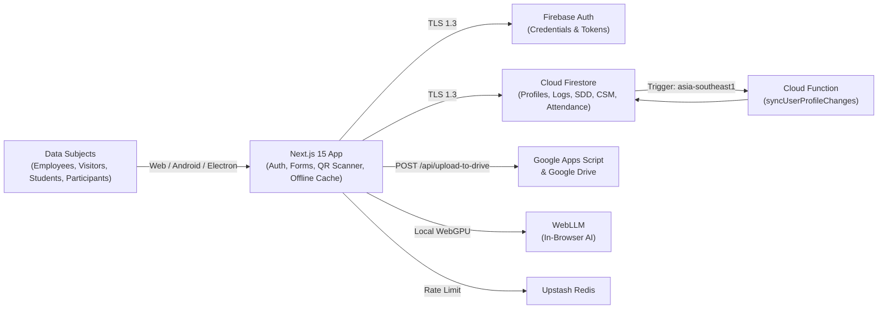

# PRIVACY IMPACT ASSESSMENT (PIA)

**Data Protection Office 2026**  
**System:** RSU EOMS Portal (Unified Archipelagic Quality Assurance / UAQA Portal)

> **INSTRUCTIONS:** This form shall be accomplished by the Project/System Owner with the assistance of the unit/campus Privacy Officer and the Data Protection Office before a new or substantially changed system, project, program, form, or data sharing involving personal data is implemented (RA 10173 Sec. 20; IRR Sec. 29; NPC Advisory 2017-03). Write "N/A" for items that do not apply. Submit the accomplished form to the DPO at `dpo@rsu.edu.ph`.

---

## PART I: PROJECT / SYSTEM INFORMATION

| Field                                | Details                                                                                                                                                                                                                                                                                                                                                                                                                                                                                                                                                                                                                                                                                                                                    |
| :----------------------------------- | :----------------------------------------------------------------------------------------------------------------------------------------------------------------------------------------------------------------------------------------------------------------------------------------------------------------------------------------------------------------------------------------------------------------------------------------------------------------------------------------------------------------------------------------------------------------------------------------------------------------------------------------------------------------------------------------------------------------------------------------- |
| **PROJECT / SYSTEM NAME**            | RSU EOMS Portal (Unified Archipelagic Quality Assurance / UAQA Portal)                                                                                                                                                                                                                                                                                                                                                                                                                                                                                                                                                                                                                                                                     |
| **UNIT / OFFICE / CAMPUS / COLLEGE** | Quality Assurance Office / Institutional EOMS & Campus Units (University-wide across all RSU Campuses)                                                                                                                                                                                                                                                                                                                                                                                                                                                                                                                                                                                                                                     |
| **PROJECT / SYSTEM OWNER**           | _[To be completed by Project/System Owner — e.g., Director, Quality Assurance Office]_                                                                                                                                                                                                                                                                                                                                                                                                                                                                                                                                                                                                                                                     |
| **UNIT PRIVACY OFFICER**             | _[To be completed by Unit Privacy Officer]_                                                                                                                                                                                                                                                                                                                                                                                                                                                                                                                                                                                                                                                                                                |
| **TYPE (✓)**                         | ☐ New system/project &nbsp;&nbsp; ☒ Change to existing &nbsp;&nbsp; ☒ Periodic review &nbsp;&nbsp; ☐ Others: ______                                                                                                                                                                                                                                                                                                                                                                                                                                                                                                                                                                                                                        |
| **PLATFORM (✓)**                     | ☐ Paper-based &nbsp;&nbsp; ☒ In-house system &nbsp;&nbsp; ☒ Cloud/third-party &nbsp;&nbsp; ☐ Others: Next.js 15 Web App, Android (Capacitor), Windows Desktop (Electron)                                                                                                                                                                                                                                                                                                                                                                                                                                                                                                                                                                   |
| **THIRD PARTIES / PROCESSORS**       | 1. **Google LLC / Firebase** (Firebase Authentication, Cloud Firestore, Firebase App Hosting, Firebase Cloud Functions in `asia-southeast1`) 2. **Google LLC (Google Drive & Google Apps Script)** (`script.google.com` webhook via `/api/upload-to-drive` and Drive link validation via `/api/validate-drive-link`) 3. **Upstash, Inc. (Upstash Redis)** (Server-side API rate limiting via `UPSTASH_REDIS_REST_URL`) 4. **Local In-Browser AI (`@mlc-ai/web-llm`)** (Runs locally on client device via WebGPU/CacheStorage; model weights fetched from MLC/HuggingFace CDN, no user data transmitted externally) _(Note: External QRServer API and legacy Genkit/Gemini starter files have been removed from the codebase.)_ |
| **TARGET IMPLEMENTATION DATE**       | Active / Ongoing Institutional Deployment (Latest codebase review: November 2026)                                                                                                                                                                                                                                                                                                                                                                                                                                                                                                                                                                                                                                                          |
| **DATE OF ASSESSMENT**               | November 20, 2026                                                                                                                                                                                                                                                                                                                                                                                                                                                                                                                                                                                                                                                                                                                          |

### DESCRIPTION, PURPOSE, AND SCOPE

**What the project does:**  
The **RSU EOMS Portal (UAQA Portal)** is Romblon State University's integrated Enterprise Quality Management System (aligned with **ISO 21001:2018** and **ISO/IEC 25010:2011**), delivered as a Next.js 15 web application, an Android mobile app (Capacitor), and a Windows desktop application (Electron). It centralizes:

- **EOMS Submission & Compliance:** Document workflows (SWOT, Operational Plans, Quality Objectives, Risk & Opportunity Registry, Procedure Manuals, PBB, GAA-BUR, SUC Levelling), multi-level approvals, and Google Drive evidence uploads/link validation.
- **Quality Assurance & Audits:** Internal Quality Audits (IQA), External Quality Audits (EQA), Corrective Action Requests (CARs), Management Reviews, Unit Monitoring, and Software Quality Evaluations.
- **CHED Programs Monitoring & Batch Data Hub:** Program registry, accreditation tracking, and XLSX batch import of sex-disaggregated student enrollment and graduation counts.
- **GAD Corner & SDD Hub:** Sex-Disaggregated Data (SDD) for students and employees, Unit Personnel Census, GAD Plan & Budget (GPB), Accomplishment Reports (AR), and a public GAD Entry portal (`/gad-entry`).
- **FIAMO Monitoring:** Facilities repair request intake, coordinator assignment, staff execution, and photographic/document evidence tracking.
- **Visitor Logbook, ARTA CSM, & Unit Activity Attendance:** Digital visitor check-in/out (`/visitor-logbook`), Client Satisfaction Measurement (`/csm-evaluate`), and QR/OTP/offline-capable unit activity attendance and device binding (`/attendance-app`, `/unit-activity-scanner`, `/evaluate`).
- **AI Assistance:** Optional client-side **WebLLM** (`@mlc-ai/web-llm`) for local in-browser executive commentary and risk treatment suggestions (no external AI API calls).

**Why personal data is needed:**  
Personal data is required to authenticate university personnel, enforce role-based access control (RBAC) across campuses and units, maintain non-repudiable audit trails for ISO 21001:2018 compliance, record employee daily/WFH accomplishments, track campus visitors and ARTA Client Satisfaction Measurement (CSM) feedback, verify physical attendance at university activities, and generate mandated Sex-Disaggregated Data (SDD) for Gender and Development (GAD) and CHED reporting.

**What is covered / excluded:**

- **Covered:** All authenticated portal users (Admins, VPs, Campus Directors, Unit Coordinators, Unit ODIMOs, Auditors, Faculty, Staff, FIAMO personnel), campus visitors, activity participants, and aggregated/sectoral GAD & CHED statistical records stored in Firestore, Google Drive, or client-side offline caches (`localStorage`).
- **Excluded:** Standalone University Student Information System (SIS) individual student gradebooks/transcripts and payroll/HRIS 201 files not uploaded to the portal.

---

## PART II: THRESHOLD ANALYSIS

_A "YES" to any item indicates that a full PIA is required._

| NO. | QUESTION                                                                                                | YES | NO  | REMARKS                                                                                                                                                                                                                                                                                                                          |
| :-: | :------------------------------------------------------------------------------------------------------ | :-: | :-: | :------------------------------------------------------------------------------------------------------------------------------------------------------------------------------------------------------------------------------------------------------------------------------------------------------------------------------- |
|  1  | Will the project collect new personal information about individuals?                                    |  ☒  |  ☐  | Collects user profiles (`users`), visitor logs (`visitorLogs`), CSM responses (`csmResponses`), personnel rosters (`unitPersonnel`), attendance & device bindings (`unitActivityAttendanceLogs`, `attendanceDeviceBindings`), employee/WFH logs (`employeeActivities`, `wfhActivities`), and repair requests (`repairRequests`). |
|  2  | Will individuals be compelled to provide personal information?                                          |  ☒  |  ☐  | Mandatory for RSU personnel to register/authenticate for EOMS compliance, WFH/daily activity logging, and activity attendance; visitors must log details at campus offices for entry/service tracking.                                                                                                                           |
|  3  | Will personal information be disclosed to parties that did not previously have routine access?          |  ☒  |  ☐  | Centralizes unit-level logs in Firestore; **remediated on Nov 20, 2026** so `visitorLogs` and `csmResponses` are scoped to `isAdmin() \|\| isSupervisor() \|\| hasUnitAccess(resource.data.unitId)` and `attendanceDeviceBindings` / `unitActivityAttendanceLogs` `list` requires authentication.                                |
|  4  | Will personal information be used for a purpose it is not currently used for?                           |  ☒  |  ☐  | Consolidates operational logs, GAD SDD, CSM, device fingerprinting, and AI-assisted risk/compliance analytics into a unified cross-module portal.                                                                                                                                                                                |
|  5  | Will sensitive personal information or privileged information be processed (RA 10173 Sec. 3(l))?        |  ☒  |  ☐  | Processes `sex` (`users`, `visitorLogs`, `csmResponses`, `unitPersonnel`), `ageGroup` (`csmResponses`), and GAD sectoral attributes (`PWD` [health/disability], `Indigenous People` [ethnic origin], `LGBTQA++`, `Solo Parent`, `Senior Citizen`) in `Employee`, `UnitPersonnelCensus`, and `gadActivities`.                     |
|  6  | Does the project involve new or intrusive technology (e.g., biometrics, CCTV, tracking, AI, cloud)?     |  ☒  |  ☐  | Uses Cloud infrastructure (Firebase/GCP), local in-browser AI (WebLLM), camera QR scanning (`html5-qrcode`), browser/device fingerprinting (`deviceFingerprint` in `attendanceDeviceBindings` & `rsu_eoms_gad_device_id`), and `localStorage` offline caching.                                                                   |
|  7  | Will personal data be transferred or stored outside the Philippines?                                    |  ☒  |  ☐  | _Corrected from draft template:_ Firebase Authentication, Cloud Firestore, Firebase App Hosting, Cloud Functions (`asia-southeast1` Singapore), Google Drive/Apps Script, and Upstash Redis store/process data on cloud servers outside the Philippines.                                                                         |
|  8  | Will the project involve large-scale or systematic processing, profiling, or automated decision-making? |  ☒  |  ☐  | University-wide systematic processing of personnel, visitors, and institutional metrics across all campuses/units, including automated compliance scoring, KPI/OKR alerts, and AI-generated risk treatment suggestions.                                                                                                          |
|  9  | Does the project involve data of minors or other vulnerable data subjects?                              |  ☒  |  ☐  | Processes student enrollment/graduation SDD, CSM `ageGroup` (`Below 20` / `19-under`), and GAD sectoral counts for `PWD`, `Senior Citizen`, `Indigenous People`, `Solo Parent`, and `Youth/Student`.                                                                                                                             |
| 10  | Will data be shared with another PIC (requiring a Data Sharing Agreement)?                              |  ☐  |  ☒  | Primary internal university system. External submissions to CHED, PCW (GAD), ARTA (CSM), and AACCUP use aggregated/statistical reports. _(If raw personal data is ever shared with external PICs, a DSA under NPC Circular 2020-03 is required.)_                                                                                |

**DPO DECISION (✓):**  
☒ **Full PIA required** &nbsp;&nbsp; ☐ PIA not required (state reason): ______________________

---

## PART III: STAKEHOLDER ENGAGEMENT

| NAME                                     | POSITION / UNIT                    | ROLE / INVOLVEMENT                   | INPUTS / CONCERNS RAISED                                                                                                                                 |
| :--------------------------------------- | :--------------------------------- | :----------------------------------- | :------------------------------------------------------------------------------------------------------------------------------------------------------- |
| _[System Owner]_                         | Director, Quality Assurance Office | Project / System Owner               | Alignment with ISO 21001:2018, CHED, AACCUP, and ARTA CSM mandates; ensuring non-repudiation of compliance records.                                      |
| _[Unit Privacy Officer]_                 | Unit / Campus Privacy Officer      | Privacy Compliance & Review          | Ensuring inline RA 10173 privacy notices on public forms (`/gad-entry`, `/visitor-logbook`, `/csm-evaluate`, `/attendance-app`) and strict RBAC scoping. |
| _[Lead Developer / ICT]_                 | System Developer / ICT Unit        | Architecture, Security & Maintenance | Hardening `firestore.rules`, disabling cleartext in `capacitor.config.ts`, managing `.env` HMAC salts, and implementing automated retention/purging.     |
| _[Campus Directors / Unit Coordinators]_ | Campus & Unit Heads                | Operational Users & Approvers        | Managing unit personnel rosters, visitor logbooks, and verifying WFH/daily activity logs without exposing unrelated units' PII.                          |
| _[GAD Focal Point System]_               | GAD Office / Coordinators          | SDD & Sectoral Data Stewardship      | Protecting sensitive sectoral data (`PWD`, `Indigenous People`, `LGBTQA++`, `Solo Parent`) and ensuring aggregate-only reporting where possible.         |

---

## PART IV: PERSONAL DATA INVENTORY

| DATA SUBJECTS                                                                                                                                      | PERSONAL INFORMATION                                                                                                                                                                                                                     | SENSITIVE PERSONAL INFORMATION (RA 10173 Sec. 3(l))                                                                                                                                | LAWFUL BASIS (SEC. 12 / 13)                                                                                                                                                                                                                                                           |
| :------------------------------------------------------------------------------------------------------------------------------------------------- | :--------------------------------------------------------------------------------------------------------------------------------------------------------------------------------------------------------------------------------------- | :--------------------------------------------------------------------------------------------------------------------------------------------------------------------------------- | :------------------------------------------------------------------------------------------------------------------------------------------------------------------------------------------------------------------------------------------------------------------------------------ |
| **Employees / Faculty / Staff / Portal Users** (`users`, `unitPersonnel`, `employeeActivities`, `wfhActivities`, `repairRequests`, `activityLogs`) | Full Name (`firstName`, `lastName`), RSU Email (`email`), Avatar URL, Role (`role`, `fiamoRole`), Campus & Unit assignments, Portfolio Google Drive links, Accessibility preferences, Daily/WFH activity descriptions, Action audit logs | `sex` (on `users` & `Employee` records); GAD sectoral affiliations in `Employee` / `UnitPersonnelCensus` (`PWD`, `Indigenous People`, `Solo Parent`, `Senior Citizen`, `LGBTQA++`) | **Sec. 12(b)/(c)/(e):** Employment/contractual necessity, legal obligation (CSC/DBM/ISO 21001:2018), public function/mandate. **Sec. 13(b)/(f):** Legal obligation (RA 9710 Magna Carta of Women / PCW GAD mandates) and explicit consent at registration (`privacyPolicyAgreed`). |
| **Campus Visitors & External Clients** (`visitorLogs`, `csmResponses`)                                                                             | Full Name (`visitorName`), Purpose of visit, Office/Person visited (`lookingFor`), Visit timestamps, Service feedback & free-text `comments`                                                                                             | `sex`, `ageGroup` (`Below 20`, `20-34`, `35-49`, `50-64`, `65 and above`), `clientType`                                                                                            | **Sec. 12(e)/(f):** Public function/mandate & legitimate interest (campus security and ARTA RA 11032 Client Satisfaction Measurement). **Sec. 13(a)/(b):** Consent & statutory compliance with ARTA/GAD sex-disaggregated reporting.                                               |
| **Activity Participants & Attendees** (`unitActivityAttendanceLogs`, `attendanceDeviceBindings`, `unitActivityEvaluations`)                        | User ID (`userId`), User Name (`userName`), Unit Name, Device Fingerprint (`deviceFingerprint`), Scan timestamps, OTP/HMAC signatures, Evaluation ratings & comments                                                                     | Potential indirect exposure of attendance at GAD/health-related events; minors if students participate                                                                             | **Sec. 12(a)/(e):** Consent / institutional mandate for university events and quality documentation.                                                                                                                                                                                  |
| **Students** (`programCompliances`, `gadActivities`, `csmResponses`)                                                                               | Aggregated enrollment & graduation counts per program, campus, year level, and semester (no individual student names in `programCompliances`)                                                                                            | Aggregated `sex` (Male/Female) and GAD sectoral counts (`Youth/Student`, `PWD`, `Indigenous People`, `Solo Parent`, `LGBTQA++`)                                                    | **Sec. 12(e) & Sec. 13(b):** Statutory mandate (CHED monitoring, RA 9710 GAD SDD).                                                                                                                                                                                                    |

---

## PART V: PERSONAL DATA FLOW

| PROCESSING STAGE           | DESCRIPTION (HOW, WHERE, BY WHOM, TOOLS USED)                                                                                                                                                                                                                                                                                                                                                                                                                                                                                                                                                                                                                                                                                                                                                                                                                                                                                                                                                | PERSONNEL WITH ACCESS                                                                                                                                      |
| :------------------------- | :------------------------------------------------------------------------------------------------------------------------------------------------------------------------------------------------------------------------------------------------------------------------------------------------------------------------------------------------------------------------------------------------------------------------------------------------------------------------------------------------------------------------------------------------------------------------------------------------------------------------------------------------------------------------------------------------------------------------------------------------------------------------------------------------------------------------------------------------------------------------------------------------------------------------------------------------------------------------------------------- | :--------------------------------------------------------------------------------------------------------------------------------------------------------- |
| **COLLECTION**             | • **Authenticated Users:** Collected via `/register` and `/complete-registration` using Firebase Auth + Firestore `users` collection, with mandatory `DataPrivacyDialog` consent (`privacyPolicyAgreed`, `privacyConsentAt`). • **Visitors & CSM:** Collected via `/visitor-logbook` (kiosk/mobile) and `/csm-evaluate` into `visitorLogs` and `csmResponses` (with offline `localStorage` fallback). • **Attendance:** Collected via `/attendance-app` and `/unit-activity-scanner` using QR (`html5-qrcode`), OTP, and `deviceFingerprint` into `attendanceDeviceBindings` and `unitActivityAttendanceLogs` (with HMAC-SHA-256 signed `localStorage` offline logs). • **GAD SDD:** Collected via authenticated SDD Hub and unauthenticated `/gad-entry` (with `rsu_eoms_gad_device_id` in `localStorage`). • **Files/Evidence:** Uploaded via `/api/upload-to-drive` to a Google Apps Script webhook, or linked via Google Drive URLs validated by `/api/validate-drive-link`. | System Users, Campus/Unit Coordinators, Office Frontdesk Staff, Public/Unauthenticated Participants (for `/gad-entry`, `/csm-evaluate`, `/attendance-app`) |
| **STORAGE**                | • **Cloud Database:** Google Cloud Firestore (`studio-9288801258-68151`), encrypted at rest (AES-256). • **Authentication:** Firebase Authentication (salted scrypt credentials). • **Document Repository:** Institutional Google Drive folders via Google Apps Script. • **Client-Side Cache:** Browser `localStorage` / `CacheStorage` for offline visitor logs (`rsu_offline_visitor_logs`), offline CSM (`rsu_offline_csm_responses`), offline attendance (`rsu_attendance_offline_logs`), device bindings (`rsu_attendance_local_binding`, `rsu_eoms_gad_device_id`), and WebLLM model weights.                                                                                                                                                                                                                                                                                                                                                                                | System Administrators, Google Cloud/Firebase (Infrastructure Processor)                                                                                    |
| **USE**                    | • Role-based dashboard analytics, compliance scoring, IQA/EQA/CAR tracking, FIAMO repair dispatch, CHED & GAD SDD reporting, and ARTA CSM consolidation. • Profile updates in `users` trigger the `syncUserProfileChanges` Cloud Function (`asia-southeast1`) to propagate `role`, `unitName`, `firstName`, `lastName`, `unitId` across 8+ collections. • WebLLM processes optional dashboard summaries and risk treatment suggestions locally in-browser with zero external data transmission.                                                                                                                                                                                                                                                                                                                                                                                                                                                                                        | Authorized RSU Personnel (Admins, VPs, Campus Directors, Unit Coordinators, Unit ODIMOs, Auditors, FIAMO Staff)                                            |
| **RETENTION**              | • `docs/DATA_HANDLING_REQUIREMENTS.md` specifies a minimum **2-year retention** for `fiamoActivityLogs`. • Automated `enforceDataRetentionPolicy` scheduled Cloud Function (`functions/src/index.ts`, weekly `asia-southeast1`) anonymizes `visitorLogs` older than 365 days and purges `unitActivityAttendanceLogs`, `errorReports`, and `activityLogs` older than 730 days (2 years).                                                                                                                                                                                                                                                                                                                                                                                                                                                                                                                                                                                                   | System Administrators, DPO                                                                                                                                 |
| **DISCLOSURE / SHARING**   | • Internal sharing across RSU offices scoped by `firestore.rules` (`visitorLogs` and `csmResponses` restricted to unit/supervisor/admin; attendance `list` restricted to signed-in users). • External reporting to CHED, PCW, ARTA, and AACCUP via exported aggregated reports.                                                                                                                                                                                                                                                                                                                                                                                                                                                                                                                                                                                                                                                                                                           | Internal RSU Units; External Regulatory Bodies (aggregated/statistical outputs)                                                                            |
| **DISPOSAL / DESTRUCTION** | • Automated weekly purge/anonymization via `enforceDataRetentionPolicy` Cloud Function (`functions/src/index.ts`) and admin-triggered `eraseUserData` callable for RA 10173 erasure requests. • Offline `localStorage` entries are cleared upon successful online sync.                                                                                                                                                                                                                                                                                                                                                                                                                                                                                                                                                                                                                                                                                                                   | System Administrators, DPO                                                                                                                                 |

### Data Flow Diagram

---

## PART VI: PRIVACY IMPACT ANALYSIS

_Compliance Status: **C** – Compliant; **P** – Partially compliant; **N** – Not compliant; **N/A** – Not applicable._

| PRIVACY PRINCIPLE / REQUIREMENT | KEY QUESTION                                                                                                                       | STATUS | FINDINGS / EVIDENCE                                                                                                                                                                                                                                                                                                                                             |
| :------------------------------ | :--------------------------------------------------------------------------------------------------------------------------------- | :----: | :-------------------------------------------------------------------------------------------------------------------------------------------------------------------------------------------------------------------------------------------------------------------------------------------------------------------------------------------------------------- |
| **TRANSPARENCY**                | Are data subjects informed of the purpose, extent, recipients, retention, and their rights through a privacy notice? (Sec. 11, 16) | **C**  | `/privacy` (`src/app/privacy/page.tsx`), `DataPrivacyDialog`, `/complete-registration`, `/unit-activity` printable forms, and `<InlinePrivacyNotice />` on all public intake routes (`/gad-entry`, `/visitor-logbook`, `/visitor-logbook/mobile`, `/csm-evaluate`, `/attendance-app`, `/evaluate`) provide RA 10173 notices and DPO contact (`dpo@rsu.edu.ph`). |
| **LEGITIMATE PURPOSE**          | Is the purpose declared, specified, and not contrary to law, morals, or public policy? (Sec. 11)                                   | **C**  | Processing directly supports ISO 21001:2018 EOMS, CHED program monitoring, PCW GAD SDD, ARTA CSM (RA 11032), and university facilities management.                                                                                                                                                                                                              |
| **PROPORTIONALITY**             | Is only the minimum personal data necessary collected and processed? (IRR Sec. 18)                                                 | **C**  | Student CHED data is aggregated; `csm-evaluate/page.tsx` now allows anonymous CSM submissions (`visitorName` optional, defaulting to `'ANONYMOUS CLIENT'`); and `/visit` generates QR codes locally via `qrcode` instead of external `api.qrserver.com`.                                                                                                        |
| **COLLECTION**                  | Is collection fair, lawful, and for a declared purpose? Is consent obtained where required?                                        | **C**  | Registration and profile completion enforce `privacyPolicyAgreed` + `privacyConsentAt`; all public intake forms display `<InlinePrivacyNotice />` prior to submission.                                                                                                                                                                                          |
| **USE AND DISCLOSURE**          | Is data used and disclosed only for the declared purpose and to authorized recipients?                                             | **C**  | `firestore.rules` scopes `visitorLogs` and `csmResponses` reads/updates to `isAdmin()                                                                                                                                                                                                                                                                           |     | isSupervisor() |     | hasUnitAccess(resource.data.unitId)`, restricts `attendanceDeviceBindings`&`unitActivityAttendanceLogs` `list` to signed-in users (`get`only for single-doc verification), and removes public`update` on attendance logs. |
| **DATA QUALITY**                | Is data kept accurate, complete, and up to date? Is there a correction process?                                                    | **C**  | Zod schema validation on forms, revision numbering (`Rev 00+`), profile editing, and `syncUserProfileChanges` Cloud Function (`functions/src/index.ts`) keeping denormalized names/roles/units synchronized.                                                                                                                                                    |
| **ORGANIZATIONAL SECURITY**     | Are roles, policies, access authorization, confidentiality undertakings, and training in place? (IRR Sec. 26)                      | **C**  | Role-based permissions, admin verification gate (`verified: boolean`), `ndaAccepted` on `officeConnectionRequests`, and documented SOPs in `docs/DPA_AND_BREACH_SOP.md`. _(Ongoing: maintain staff privacy training logs.)_                                                                                                                                     |
| **PHYSICAL SECURITY**           | Are storage areas, devices, and paper records secured? (IRR Sec. 27)                                                               | **C**  | Cloud-hosted backend with physical/environmental controls; kiosk/mobile SOPs in `docs/DPA_AND_BREACH_SOP.md` and HTTPS-only enforcement in `capacitor.config.ts`.                                                                                                                                                                                               |
| **TECHNICAL SECURITY**          | Are encryption, access control, logging, backup, and vulnerability management in place? (IRR Sec. 28)                              | **C**  | Security headers in `next.config.ts`, HMAC-SHA-256 QR/offline signatures, Upstash rate limiting, tightened `firestore.rules`, `capacitor.config.ts` (`cleartext: false`, `allowMixedContent: false`), local QR generation, and removal of external Gemini wiring from `risk-form-dialog.tsx`.                                                                   |
| **RETENTION AND DISPOSAL**      | Is data retained only as long as necessary and securely disposed of? (Sec. 11(e))                                                  | **C**  | Automated `enforceDataRetentionPolicy` scheduled Cloud Function (`functions/src/index.ts`) anonymizes `visitorLogs` after 365 days and purges `unitActivityAttendanceLogs`, `errorReports`, and `activityLogs` after 730 days (2 years).                                                                                                                        |
| **DATA SUBJECT RIGHTS**         | Can access, rectification, erasure, objection, and portability requests be fulfilled? (Sec. 16–18)                                 | **C**  | `/privacy` directs data subjects to `dpo@rsu.edu.ph`; `exportUserData` (portability/access) and `eraseUserData` (erasure/redaction) Cloud Functions implemented in `functions/src/index.ts` alongside `/profile` self-rectification.                                                                                                                            |
| **THIRD PARTIES / DSA**         | Are processors bound by an outsourcing agreement and data sharing covered by a DSA? (IRR Sec. 43–45; NPC Circular 2020-03)         | **P**  | Technical processor inventory and DPA checklist documented in `docs/DPA_AND_BREACH_SOP.md` (Google Cloud/Firebase, Google Workspace/Drive, Upstash). _(Administrative action remaining: DPO/Legal formal archival of signed Google & Upstash DPAs.)_                                                                                                            |
| **CROSS-BORDER FLOWS**          | If data leaves the Philippines, is it adequately protected? (Sec. 21)                                                              | **P**  | Cloud Functions pinned to `asia-southeast1` (Singapore), TLS/AES-256 enforced, and `docs/DPA_AND_BREACH_SOP.md` documents cross-border safeguards. _(Administrative action remaining: formal DPO sign-off on Google Cloud & Upstash DPA archival.)_                                                                                                             |
| **BREACH MANAGEMENT**           | Is the project covered by the DBRT and the breach management procedure? (IRR Sec. 38)                                              | **C**  | `activityLogs`, `errorReports`, `dpo@rsu.edu.ph`, and the 72-hour NPC Data Breach Response Team (DBRT) runbook in `docs/DPA_AND_BREACH_SOP.md` are in place.                                                                                                                                                                                                    |

---

## PART VII: PRIVACY RISK ASSESSMENT

_Likelihood (L) and Impact (I): 1 (low) to 4 (very high). Risk Rating = L × I: 1–3 Low; 4–8 Medium; 9–12 High; 16 Critical._

|  NO.   | THREAT / VULNERABILITY                                                                                                                        | RISK TO DATA SUBJECTS                                                                                                                         |  L  |  I  |     RATING     | EXISTING CONTROLS                                                                                                                                                                     | RESIDUAL RISK  |
| :----: | :-------------------------------------------------------------------------------------------------------------------------------------------- | :-------------------------------------------------------------------------------------------------------------------------------------------- | :-: | :-: | :------------: | :------------------------------------------------------------------------------------------------------------------------------------------------------------------------------------ | :------------: |
| **1**  | **Unauthenticated public read/write/update** on `attendanceDeviceBindings` and `unitActivityAttendanceLogs`                                   | Anyone on the internet can enumerate `userId`, `userName`, `deviceFingerprint`, and attendance logs, or tamper with/forge attendance records. |  3  |  4  | **12 (High)**  | `firestore.rules` updated: `get`-only for single-doc lookup, `list` restricted to `isSignedIn()`, `update` restricted to authorized unit/supervisor/admin users, `delete` admin-only. |  **Low (3)**   |
| **2**  | **Overly broad `isSignedIn()` access** on `users`, `visitorLogs`, `csmResponses`, and `unitPersonnel`                                         | Authenticated users could read/modify unrelated campus visitor logs or CSM responses.                                                         |  3  |  3  |  **9 (High)**  | `firestore.rules` updated: `visitorLogs` and `csmResponses` scoped to `isAdmin() \|\| isSupervisor() \|\| hasUnitAccess(resource.data.unitId)` with admin-only delete.                |  **Low (3)**   |
| **3**  | **Cleartext & Mixed Content enabled in Android app** (`capacitor.config.ts`)                                                                  | Potential man-in-the-middle (MitM) interception of session tokens or personal data on untrusted Wi-Fi.                                        |  2  |  4  | **8 (Medium)** | `cleartext: false` and `allowMixedContent: false` enforced in `capacitor.config.ts`; HTTPS-only (`https://eoms.rsu.edu.ph`).                                                          |  **Low (2)**   |
| **4**  | **Unencrypted `localStorage` offline PII & fallback HMAC salts** (`visitor-logbook`, `attendance-app`, `unit-activity-crypto.ts`)             | Shared kiosks or lost devices expose cached visitor names, sex, CSM comments, and attendance logs; missing env salts weaken HMAC.             |  2  |  3  | **6 (Medium)** | Sync-and-clear on reconnect; env var salt overrides documented in `.env.example` with production warning in `unit-activity-crypto.ts`.                                                |  **Low (3)**   |
| **5**  | **Missing inline Privacy Notices on public intake forms** (`/gad-entry`, `/visitor-logbook`, `/csm-evaluate`, `/attendance-app`, `/evaluate`) | Violation of Right to be Informed (RA 10173 Sec. 16) for visitors, external clients, and event participants.                                  |  3  |  2  | **6 (Medium)** | `<InlinePrivacyNotice />` embedded on all 6 public intake/evaluation routes, linking to `/privacy` and `dpo@rsu.edu.ph`.                                                              |  **Low (2)**   |
| **6**  | **Undocumented cross-border cloud processors & missing DPAs** (Firebase/GCP, Google Apps Script, Upstash)                                     | Non-compliance with RA 10173 Sec. 21 & IRR Sec. 43–45; unclear liability and data residency terms.                                            |  2  |  4  | **8 (Medium)** | Cloud Functions pinned to `asia-southeast1`; standard Google Cloud TLS/AES-256 security; DPA checklist in `docs/DPA_AND_BREACH_SOP.md`.                                               | **Medium (4)** |
| **7**  | **Absence of automated data retention & disposal**                                                                                            | Indefinite retention of visitor logs, attendance, and activity logs increases breach blast radius and violates Sec. 11(e).                    |  3  |  2  | **6 (Medium)** | Scheduled Cloud Function `enforceDataRetentionPolicy` anonymizes `visitorLogs` after 365 days and purges old logs after 730 days.                                                     |  **Low (2)**   |
| **8**  | **Residual unused Genkit/Gemini starter wiring** (`src/ai/` imported in `src/components/risk/risk-form-dialog.tsx`)                           | Unintended external AI calls if a Gemini API key were ever added.                                                                             |  1  |  2  |  **2 (Low)**   | `src/ai/` removed and `risk-form-dialog.tsx` routed to local in-browser WebLLM.                                                                                                       |  **Low (1)**   |
| **9**  | **External QR API dependency** (`api.qrserver.com` in `src/app/visit/page.tsx`)                                                               | External server logs client IP and requested redirect URL when generating APK download QR codes.                                              |  1  |  2  |  **2 (Low)**   | Replaced with local client-side `qrcode` generation in `src/app/visit/page.tsx`.                                                                                                      |  **Low (1)**   |
| **10** | **Lack of formal DBRT runbook & DSR export/erasure tooling**                                                                                  | Delayed NPC 72-hour breach reporting or inability to fulfill data subject access/erasure requests across denormalized collections.            |  2  |  3  | **6 (Medium)** | `exportUserData` & `eraseUserData` Cloud Functions implemented in `functions/src/index.ts`; 72-hour DBRT & DSR SOP in `docs/DPA_AND_BREACH_SOP.md`.                                   |  **Low (2)**   |

---

## PART VIII: RECOMMENDED PRIVACY SOLUTIONS / ACTION PLAN

| RISK NO. | RECOMMENDED MEASURE                                                                                                                                                                                                                                 | RESPONSIBLE UNIT / PERSON                    | TARGET DATE    |                       STATUS                        |
| :------: | :-------------------------------------------------------------------------------------------------------------------------------------------------------------------------------------------------------------------------------------------------- | :------------------------------------------- | :------------- | :-------------------------------------------------: |
|  **1**   | **Lock down attendance Firestore rules:** Restrict `attendanceDeviceBindings` and `unitActivityAttendanceLogs` `list` to signed-in users, `get`-only for public single-doc lookup, and restrict `update` to authorized unit/supervisor/admin users. | ICT / Lead Developer                         | Nov 20, 2026   |                    **Completed**                    |
|  **2**   | **Enforce strict least-privilege in `firestore.rules`:** Scope `visitorLogs` and `csmResponses` reads/updates to `isAdmin() \|\| isSupervisor() \|\| hasUnitAccess(resource.data.unitId)` and `delete` to `isAdmin()`.                              | ICT / Lead Developer                         | Nov 20, 2026   |                    **Completed**                    |
|  **3**   | **Harden Capacitor Android config:** Set `cleartext: false` and `allowMixedContent: false` in `capacitor.config.ts`.                                                                                                                                | ICT / Mobile Developer                       | Nov 20, 2026   |                    **Completed**                    |
|  **4**   | **Enforce production HMAC salts & offline cache hygiene:** Add production warning in `unit-activity-crypto.ts` for missing `NEXT_PUBLIC_ATTENDANCE_*` salts and ensure sync-and-clear on reconnect.                                                 | ICT / Lead Developer                         | Nov 20, 2026   |                    **Completed**                    |
|  **5**   | **Add inline RA 10173 Privacy Notices:** Embed `<InlinePrivacyNotice />` linking to `/privacy` and `dpo@rsu.edu.ph` on `/gad-entry`, `/visitor-logbook`, `/visitor-logbook/mobile`, `/csm-evaluate`, `/attendance-app`, and `/evaluate`.            | QA Office / Unit Privacy Officer / Developer | Nov 20, 2026   |                    **Completed**                    |
|  **6**   | **Execute DPAs & Cross-Border Documentation:** Archive signed Data Processing Agreements (DPAs) / Google Cloud Data Processing Addendum for Firebase, Google Workspace/Drive, and Upstash per `docs/DPA_AND_BREACH_SOP.md`.                         | DPO / Legal / System Owner                   | Within 60 days | **In Progress (SOP Ready; Pending Legal Sign-off)** |
|  **7**   | **Implement Retention & Disposal Automation:** Deploy `enforceDataRetentionPolicy` scheduled Cloud Function (`functions/src/index.ts`) to anonymize `visitorLogs` (365 days) and purge old logs (730 days).                                         | DPO / ICT / Lead Developer                   | Nov 20, 2026   |    **Completed (Code Ready; Deploy Functions)**     |
|  **8**   | **Remove unused Genkit/Gemini starter files:** Disconnect `suggestRiskTreatment` in `src/components/risk/risk-form-dialog.tsx` (routed to local WebLLM) and delete `src/ai/`.                                                                       | ICT / Lead Developer                         | Nov 20, 2026   |                    **Completed**                    |
|  **9**   | **Replace external QR API with local `qrcode` package:** Use `qrcode` locally in `src/app/visit/page.tsx` instead of `api.qrserver.com`.                                                                                                            | ICT / Lead Developer                         | Nov 20, 2026   |                    **Completed**                    |
|  **10**  | **Establish DBRT & DSR SOPs:** Implement `exportUserData` & `eraseUserData` Cloud Functions (`functions/src/index.ts`) and document the 72-hour DBRT & DSR SOP in `docs/DPA_AND_BREACH_SOP.md`.                                                     | DPO / QA Office / ICT                        | Nov 20, 2026   |    **Completed (Code Ready; Deploy Functions)**     |

---

## PART IX: CONCLUSION AND DPO RECOMMENDATION

- **OVERALL RESIDUAL RISK (✓):** ☒ **Low** _(after technical remediations applied on Nov 20, 2026)_ &nbsp;&nbsp; ☐ Medium &nbsp;&nbsp; ☐ High &nbsp;&nbsp; ☐ Critical
- **DPO RECOMMENDATION (✓):** ☐ Proceed &nbsp;&nbsp; ☒ **Proceed subject to implementation of Part VIII measures** _(only administrative DPA archival & formal sign-off remain)_ &nbsp;&nbsp; ☐ Do not proceed / redesign
- **REMARKS:**  
  All technical remediations identified in this assessment have been implemented as of November 20, 2026: hardened `firestore.rules`, HTTPS-only enforcement in `capacitor.config.ts`, `<InlinePrivacyNotice />` on all public intake pages, anonymous CSM option, local QR generation, removal of unused Genkit/Gemini starter files, automated retention/anonymization (`enforceDataRetentionPolicy`), DSR portability/erasure Cloud Functions (`exportUserData`, `eraseUserData`), and the DBRT/DPA SOP (`docs/DPA_AND_BREACH_SOP.md`). Remaining actions are administrative: deploying the updated `firestore.rules` and `functions`, archiving signed third-party DPAs (Google Cloud/Firebase & Upstash), and completing Part X sign-off.
- **NEXT REVIEW DATE:** November 20, 2027 _(or immediately upon remediation of Part VIII High risks or significant system changes, including the planned Appwrite migration)_.

---

## PART X: SIGN-OFF

| Prepared by:                                                                                                          | Reviewed by:                                                                                                        | Assessed by:                                                                                                           |
| :-------------------------------------------------------------------------------------------------------------------- | :------------------------------------------------------------------------------------------------------------------ | :--------------------------------------------------------------------------------------------------------------------- |
|   ____________________________ **SIGNATURE OVER PRINTED NAME** PROJECT / SYSTEM OWNER Date: __________ |   ____________________________ **SIGNATURE OVER PRINTED NAME** UNIT PRIVACY OFFICER Date: __________ |   ____________________________ **SIGNATURE OVER PRINTED NAME** DATA PROTECTION OFFICER Date: __________ |

**Approved by:**

---

**SIGNATURE OVER PRINTED NAME**  
UNIVERSITY PRESIDENT  
Date: __________

---

### FOR INTERNAL USE ONLY (DATA PROTECTION OFFICE)

| Field                                                | Details                                                                                   |
| :--------------------------------------------------- | :---------------------------------------------------------------------------------------- |
| **PIA NO.**                                          |                                                                                           |
| **RECEIVED BY**                                      |                                                                                           |
| **DATE RECEIVED**                                    |                                                                                           |
| **ENTERED IN PIA TRACKER / RISK REGISTER / RPA (✓)** | ☐ PIA Tracker &nbsp;&nbsp; ☐ Risk Register &nbsp;&nbsp; ☐ Record of Processing Activities |
| **REMARKS**                                          |                                                                                           |
